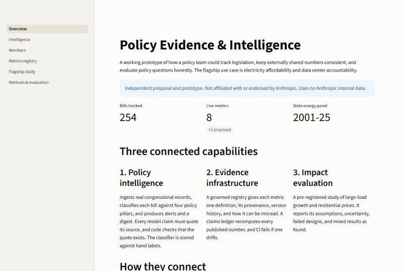
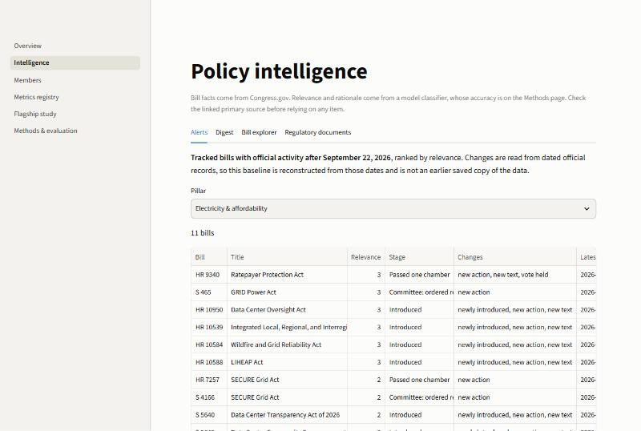
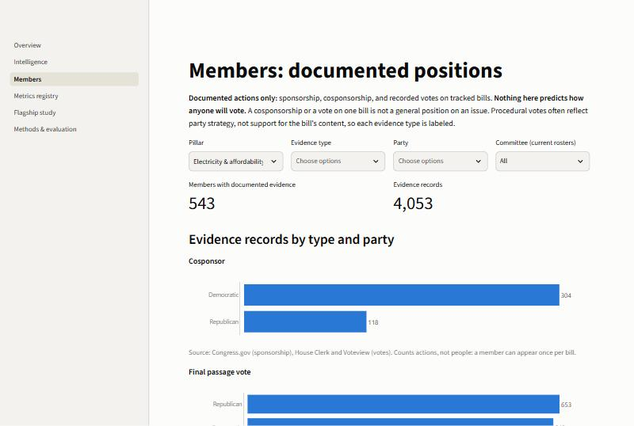
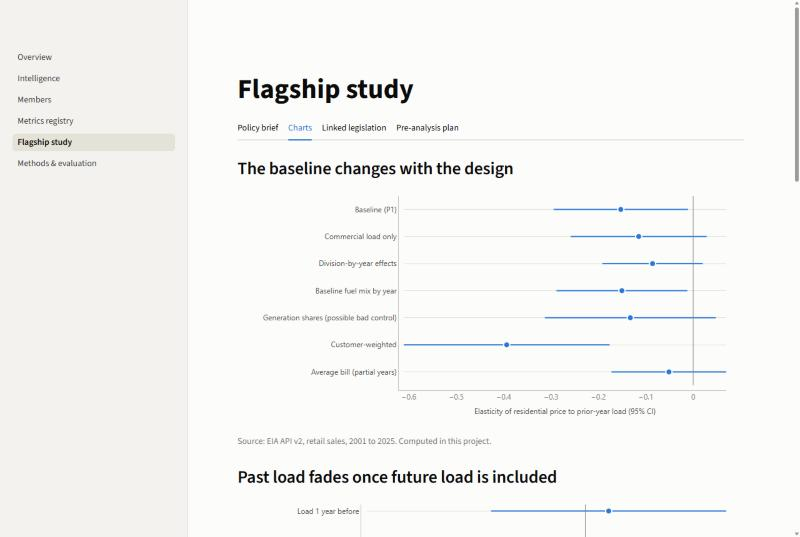
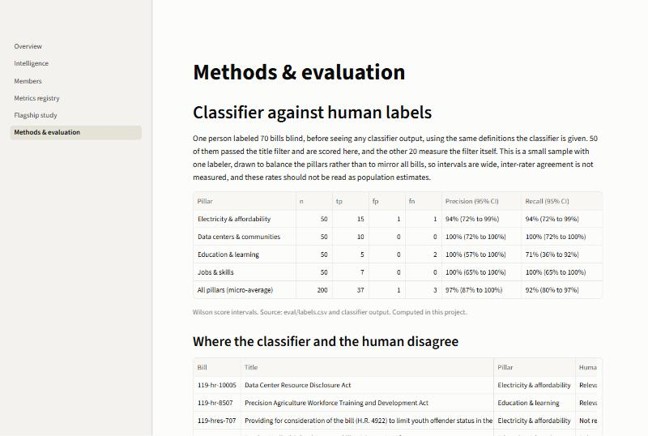
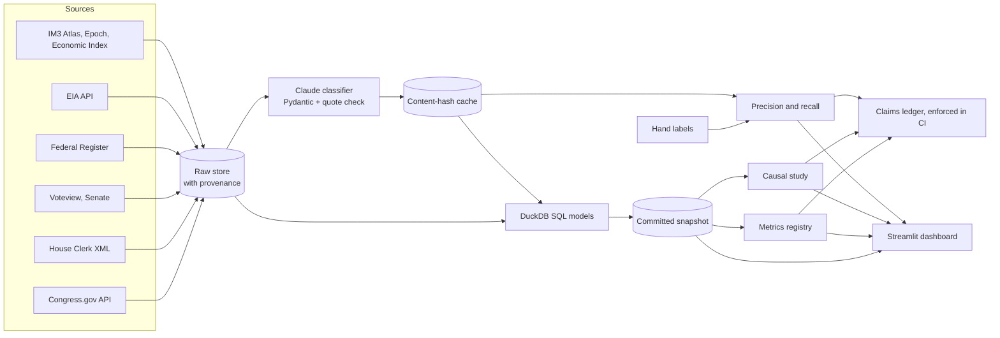

# Policy Evidence & Intelligence

> **Independent proposal and prototype. Not affiliated with or endorsed by Anthropic. It uses no
> Anthropic internal data.** Where the proposal would need internal data, it shows a schema with no
> values.

Policy teams need to know what is moving in Congress, keep the numbers they share consistent, and
answer contested questions with evidence that survives scrutiny. These jobs usually sit in separate
spreadsheets and documents, so a number can drift and a claim can outrun its evidence. This prototype
connects them, using electricity affordability and data center accountability as the flagship case. It
tracks real federal legislation with a classifier scored against hand labels, governs metrics in a single
registry that CI checks, and runs a pre-registered study of whether large-load growth raised residential
electricity prices.



## Findings

**Electricity prices.** State data through 2025 shows no evidence that faster large-load growth came
with higher residential prices, and it doesn't show that load growth lowered them either. The
baseline elasticity is −0.153 (95% interval −0.294 to −0.011), but that association sits on load that
had not arrived yet, which fits low-price states attracting load, and the pre-registered staggered
design was uninformative with only 3 treated states. State averages through 2025 can't speak to one
utility's customers, regional capacity markets, or much of the AI-era buildout. See the
[policy brief](analysis/flagship_case_study.md).

**Bill tracking.** The classifier reached a precision of 97% and a recall of 92% on 50 hand-labeled
bills, with wide intervals from one labeler. The bigger weakness comes earlier in the pipeline: the title
filter that picks which bills reach the classifier likely catches only about 37% of relevant bills
(range 23% to 62%, from a hand-labeled sample of rejected bills), so the 254 bills tracked are a useful
set, not a complete one.

## Quickstart

### Demo mode

No API keys are needed. The app runs from the committed snapshot. You need
[uv](https://docs.astral.sh/uv/).

```bash
git clone https://github.com/galarcon0803/policy-evidence-intelligence && cd policy-evidence-intelligence
```

```bash
uv sync
```

```bash
uv run streamlit run app/streamlit_app.py
```

### Full mode

Copy `.env.example` to `.env` and add your own Congress.gov, EIA, and Anthropic API keys. The commands
are in [docs/architecture.md](docs/architecture.md#running-in-full-mode). The IM3 Atlas has to be
downloaded by hand. Classifying this bill set cost about $6 through the Batch API, including the pilot
and repeat run. Re-runs reuse the cache and pay only for changed bills.

## What's inside

**Policy intelligence.** Pulls every bill in the 119th Congress from Congress.gov, keeps those whose
titles match the pillar keywords, and classifies them against four pillars: electricity and affordability,
data centers and communities, education and learning, and jobs and skills. Every model claim must quote
its source, and code checks that the quote exists. The output is ranked alerts, a
[digest](docs/digest_latest.md), a bill explorer, and a member view. The member view shows only
documented actions, labeled by type (sponsor, cosponsor, procedural vote, final passage vote). It makes
no vote predictions.





**Evidence infrastructure.** [`metrics/registry.yaml`](metrics/registry.yaml) gives each metric one
definition, its provenance, its version history, what it should inform, and how it can be misread. Three
proposed internal metrics are schema only, including energy per quality-adjusted workload, which sits next
to absolute consumption because an efficiency gain can hide rising total use. A
[claims ledger](metrics/published_claims.yaml) pins the numbers in this README and the brief, and CI
fails if one drifts from its source. [`docs/comms_measurement.md`](docs/comms_measurement.md) is a design
for communications, paid media, and public affairs measurement. It is a design only, with no data.

**Impact evaluation.** A [pre-analysis plan](analysis/pre_analysis_plan.md) was committed before any
estimate. The [brief](analysis/flagship_case_study.md) reports pre-trends, robustness checks, placebos,
threats to identification, and the designs that failed. Every deviation from the plan is listed.





## Architecture



Design decisions are in [docs/architecture.md](docs/architecture.md).

## What's real, what isn't, and what's out of scope

| Item | Status |
|---|---|
| Bills, sponsors, cosponsors, actions, summaries | **Real**, from Congress.gov, fetched 2026-11-06 |
| House roll call votes | **Real**, from the House Clerk |
| Senate roll call votes | **Real but secondary**, from Voteview (UCLA), because senate.gov refused this client. Limited to tracked bills |
| Electricity prices and sales | **Real**, from EIA, 2001 to 2025 |
| Data center locations | **Real but incomplete**, from the IM3 Atlas (OpenStreetMap) and Epoch AI |
| Claude usage metrics | **Real public release**, the Anthropic Economic Index. Not internal data |
| Pillar relevance, lens flags, questions for the team | **Model output**, scored against hand labels |
| Internal metrics such as energy per workload and grid costs covered | **Schema only.** No value exists or is shown, and nothing is synthetic |

**Out of scope:** state legislation and utility commission dockets, where most rate decisions happen;
news; non-US policy, although the role this proposal addresses covers policymakers worldwide; and any
prediction of how a legislator will vote.

Sources and licenses are in [data/snapshot/NOTICE.md](data/snapshot/NOTICE.md). The state-level Atlas
table is shared under ODbL 1.0, © OpenStreetMap contributors.

## Limitations

- **The title filter misses bills.** The Congress.gov list has no keyword search, so bills are filtered
  locally by title. Of 10 rejected near-miss bills, the labeler marked 3 relevant. The other 10 rejected
  bills had none, but they stand in for 17,785 bills, and a sample of 10 still allows a rate up to 28%.
- **One labeler, small sample.** The sample was drawn to balance the pillars, so its rates are not
  population estimates. Inter-rater agreement is not measured.
- **Failures are kept visible.** One bill still fails validation after one retry and is absent from every
  page. 20 of 3,606 quotes were not found in their cited source, and they stay flagged in the app.
- **The proxy is noisy.** C&I sales also capture manufacturing, crypto mining, and oil and gas. There is
  no dated, all-state data center capacity series, so the study can't isolate data centers.
- **Senate votes rely on Voteview**, whose site states no data license. Only 1 Senate vote is in the
  snapshot, and its tally matches the Congress.gov action record.
- **Alerts use a reconstructed baseline.** They read dated official records since 2026-09-22 and don't
  compare two saved copies. That date was chosen because Congress was largely out before the 2026
  election.
- **Regulatory documents are keyword-matched**, and their precision was not measured.
- **The snapshot does not update on its own.** The 119th Congress ends on January 3, 2027, and bills not
  enacted by then die.

## Roadmap

1. Widen bill coverage past the title filter, starting with the near-miss group, and measure the gain.
2. Add state legislation and utility commission dockets, where cost allocation is actually decided.
3. Move the flagship study to utility level, with dated capacity data.
4. Add news ingestion, and evaluate coverage accuracy per the communications measurement design.
5. Add a second labeler and report inter-rater agreement.
6. Run scheduled refreshes, with alerts built from true snapshot diffs.

## How AI was used

Claude Code wrote the code, SQL, tests, and documents under the author's direction, including the study's
analysis and the first drafts of the brief. The author set the scope and made the decisions, and
hand-labeled the evaluation set blind, before seeing classifier output for those bills. Claude Sonnet 5.5
(`claude-sonnet-5-5`) is the bill classifier in the pipeline, and its output is labeled as model output
throughout. The study's numbers come from code run on public data and not from a model's judgment.

## Development

```bash
uv sync --group dev
```

```bash
uv run pytest -q
```

```bash
uv run ruff check .
```

```bash
uv run python -m pei.metrics.registry
```

CI runs ruff and pytest on every push, including the registry validator and the claims ledger.
