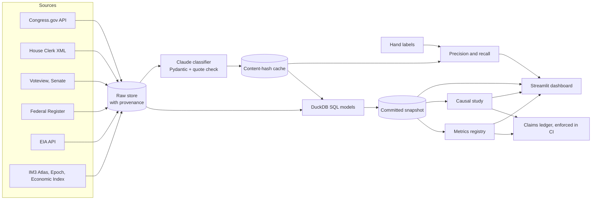

# Architecture



## Design decisions

| Decision | Why |
|---|---|
| Code in `src/pei/` rather than `src/` directly | Installs as a real package, so tests, scripts, and the app import it the same way |
| DuckDB with SQL files | Transforms stay readable and reviewable, and need no server |
| Demo runs from committed Parquet | Interviewers need no keys, and the numbers they see are the ones the ledger checks |
| Raw store is not committed | It is large and reproducible. Only derived tables are published, which also limits redistribution of sources |
| Deterministic quote check | A model can't be trusted to grade its own citations, so code verifies each quote |
| Cache keyed on content, prompt, model, and effort | Reruns pay only for real changes, and every result stays tied to what produced it |
| Change type computed in SQL | Whether a bill changed is a fact in the records, so it doesn't need a model |
| Metric logic lives only in the registry | One definition per number is the whole point. A pattern check flags obvious duplicates |

## Running in full mode

```bash
uv run python -m pei.ingest.eia
```

```bash
uv run python -m pei.ingest.public_files
```

```bash
uv run python -m pei.ingest.congress
```

```bash
uv run python -m pei.ingest.votes
```

```bash
uv run python -m pei.ingest.federal_register
```

```bash
uv run python -m pei.classify.documents
```

```bash
uv run python -m pei.classify.run
```

```bash
uv run python -m pei.transform.build --snapshot
```

```bash
uv run python -m pei.analysis.study
```

```bash
uv run python -m pei.metrics.registry
```

The IM3 Atlas has no public download link that I could find, so it must be downloaded by hand from
[its repository record](https://data.msdlive.org/records/qxpk8-yae09) into `data/raw/atlas/`.
